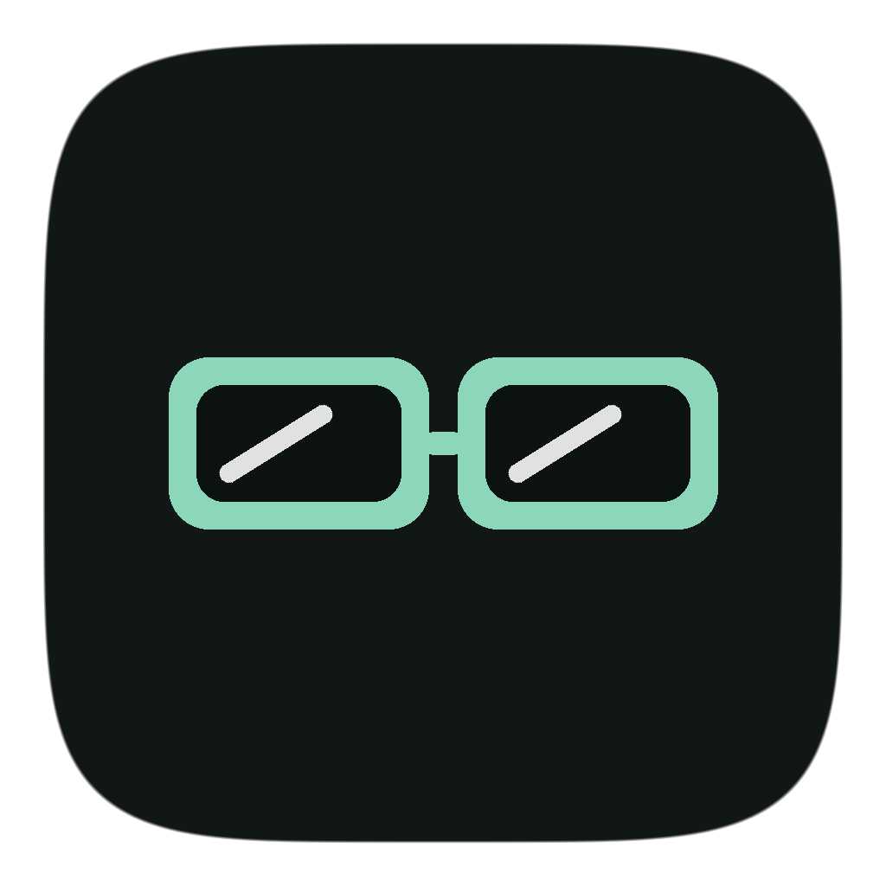

<p align="center">
  
</p>

<h1 align="center">Nerd</h1>

<p align="center">
  A fast, native terminal. The shell runs on your machine.
  <br>
  <a href="#about">About</a>
  ·
  <a href="#run-it">Run it</a>
  ·
  <a href="#shortcuts">Shortcuts</a>
  ·
  <a href="CONTRIBUTING.md">Contributing</a>
  ·
  <a href="docs/compatibility.md">Compatibility</a>
</p>

## About

Nerd is a terminal emulator for macOS, Windows, and Linux. It starts a real shell in a local PTY and draws the window with wgpu. You do not need an account or an API key. The shell still works with Ask AI turned off and with no network.

The terminal uses the [Alacritty terminal engine](https://github.com/alacritty/alacritty/tree/master/alacritty_terminal) for VT emulation and PTY support, including ConPTY on Windows.

Nerd is open source under the [MIT license](LICENSE). The glasses icon is original to this repository. The interface uses [Inter](https://github.com/rsms/inter) under the [SIL Open Font License](assets/fonts/Inter-OFL.txt).

## What you can do

**Run a real shell.** Nerd starts your shell in a local PTY. Programs you run have their usual access to your files and network. A stopped shell can be restarted from its screen.

**Keep shells after you close the window.** On macOS and Linux, a small Nerd process keeps the shells alive. Quit Nerd, open it again, and those shells are still there, with their output. Closing one screen while another is open stops that shell. Sleep still pauses a shell that is running on this computer.

**Use one shell, or several at once.** **Tabs** shows one shell at a time, with a tab for each session. **Split** shows several shells in one window. Split right or down from a screen’s title bar, drag a screen by its name onto another screen to move it, and drag the gap to resize. Each screen has its own close button.

**Work with the text.** Drag to select. Double-click a word, triple-click a line, or select all visible text. Copy and paste from the keyboard or the right-click menu. A long paste shows a preview and starts on Cancel, so an accidental Enter does not send it. Click in the grid to move the cursor. Search the scrollback, and jump back to the latest output.

**Find a file or folder by name.** The file search looks for the name you type. On macOS it asks Spotlight, and it can limit the list to files or folders.

**Ask AI when you want to.** Ask AI is off until you turn it on. You can use Ollama on this machine, or paste a key for a provider you choose. Nerd shows the text it will send. It does not run a command until you approve it. You can select and copy the answer.

**Change how it looks.** Light and dark appearance, text size, and cursor style are saved on this computer. A session list sits beside the terminal. Hide it when you want the shell to fill the window. A command palette and the shortcut list are in the app.

## Shortcuts

| Action | macOS | Windows and Linux |
| --- | --- | --- |
| New session | ⌘T | Ctrl+Shift+T |
| Close the focused screen | ⌘W | Ctrl+Shift+W |
| Split right | ⌘D | Ctrl+Shift+D |
| Split down | ⌘⇧D | Ctrl+Alt+D |
| Previous / next session | ⌘⇧[ / ⌘⇧] | Ctrl+Page Up / Ctrl+Page Down |
| Find in scrollback | ⌘F | Ctrl+Shift+F |
| Find a file or folder | ⇧⌘Space | Ctrl+Shift+Space |
| Command palette | ⇧⌘P | Ctrl+Shift+P |
| Ask AI | Shift+Space | Shift+Space |
| Ask AI from the menu | ⇧⌘I | Ctrl+Shift+I |
| Toggle the session list | Option+⌘S | Ctrl+Shift+B |
| Copy selection | ⌘C | Ctrl+Shift+C |
| Select all visible text | ⌘A | Ctrl+Shift+A |
| Paste | ⌘V | Ctrl+Shift+V |
| Text size | ⌘+ / ⌘− / ⌘0 | Ctrl+Plus / Ctrl+Minus / Ctrl+0 |

On macOS, **⌘,** opens Settings. The **View** menu can read the visible output aloud to the accessibility tree.

## Run it

Install [Rust with rustup](https://rustup.rs/). This repository selects the toolchain. Install the libraries listed in the [contributor guide](CONTRIBUTING.md), then from a desktop session:

```sh
cargo run --locked -p nerd
```

Or use the script for your system:

```sh
./Deploy/runOnMac.sh
./Deploy/runOnWindows.sh
./Deploy/runOnLinux.sh
```

`runOnWindows.sh` is for Git Bash. `runOnLinux.sh` needs a graphical session. On macOS, `./platform/macos/build-app.sh` also builds `target/Nerd.app`, which you can open from Finder.

## Release packages

On a Mac with Rust, Docker, Wine, and network access, this builds the three desktop packages into `release/`:

```sh
./Deploy/generateRelease.sh
```

The results are `release/macos/Nerd-<version>-<arch>.dmg`, `release/windows/Nerd-<version>-x64.exe`, and `release/linux/Nerd-<version>-x64.AppImage`. The Windows file is an NSIS installer built with Wine. The macOS package matches the Mac that runs the script.

## Check the build

```sh
cargo fmt --all -- --check
cargo clippy --locked --workspace --all-targets -- -D warnings
cargo test --locked --workspace
```

See the [compatibility notes](docs/compatibility.md) for manual checks, and the [implementation status](docs/implementation-status.md) for what is still ahead.

When you report a problem, include the operating system and a short reproduction. Remove credentials, local paths, and private repository names from logs and screenshots.
